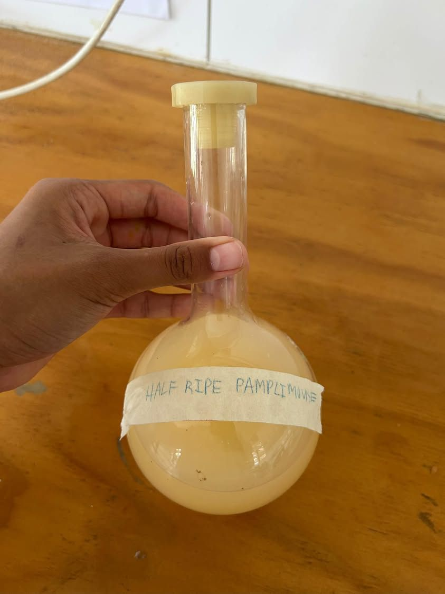
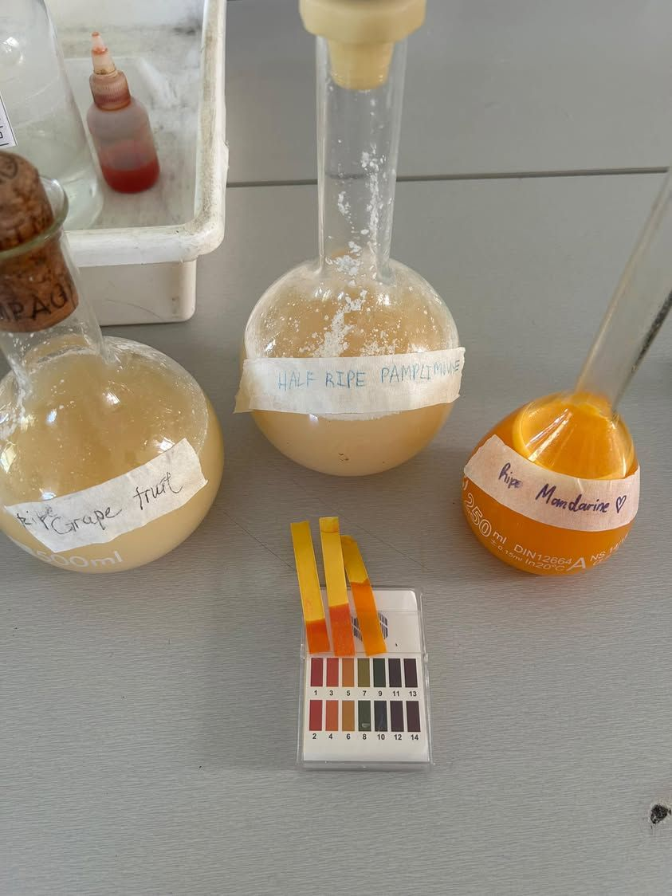
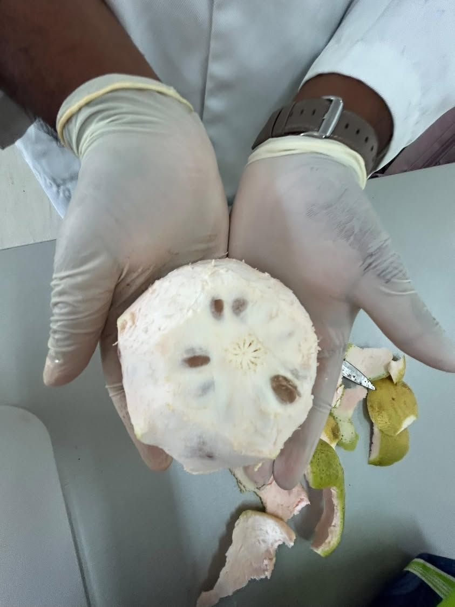
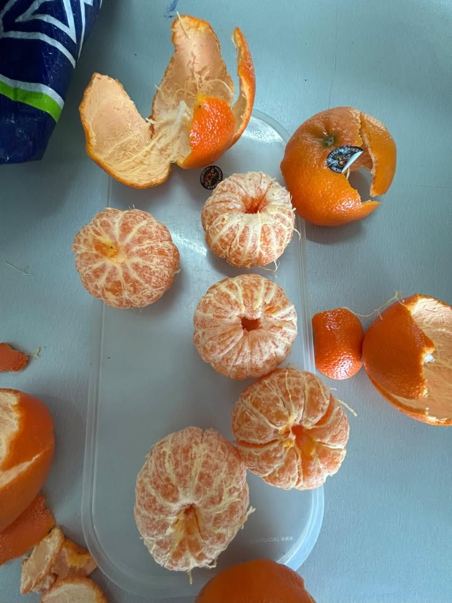
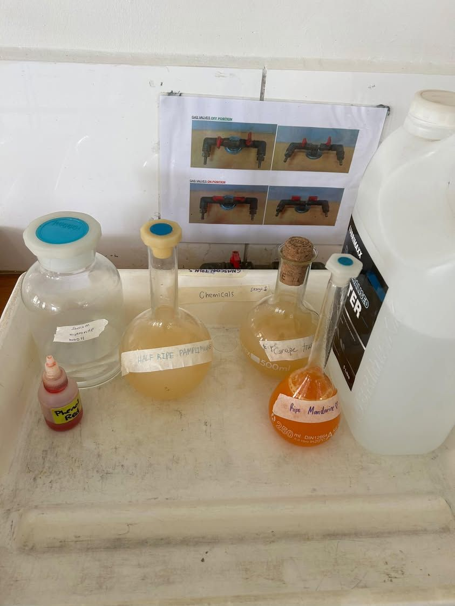
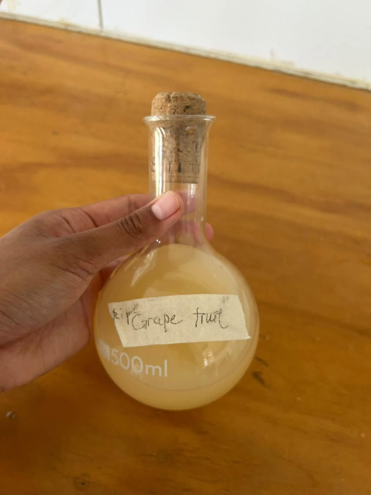
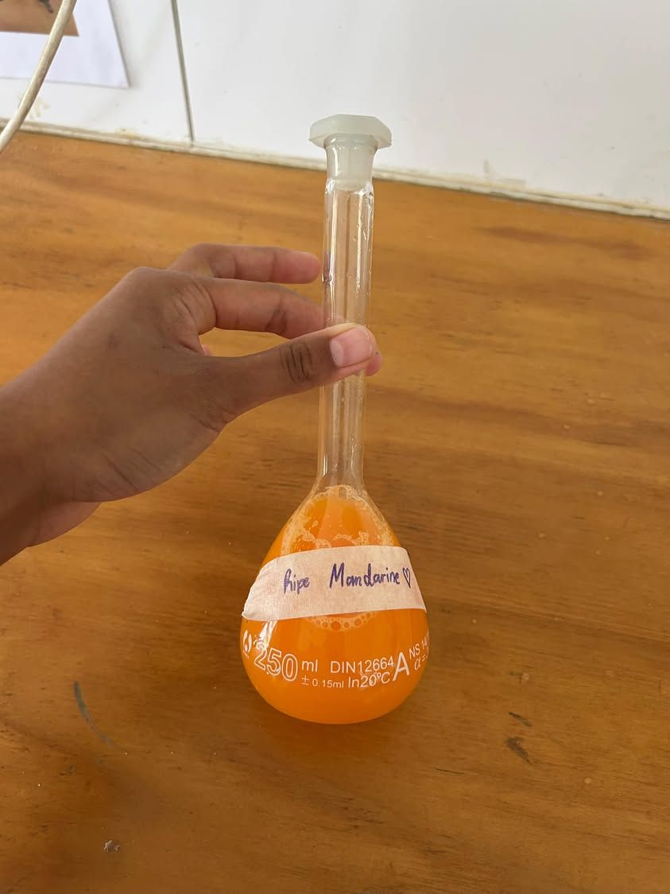
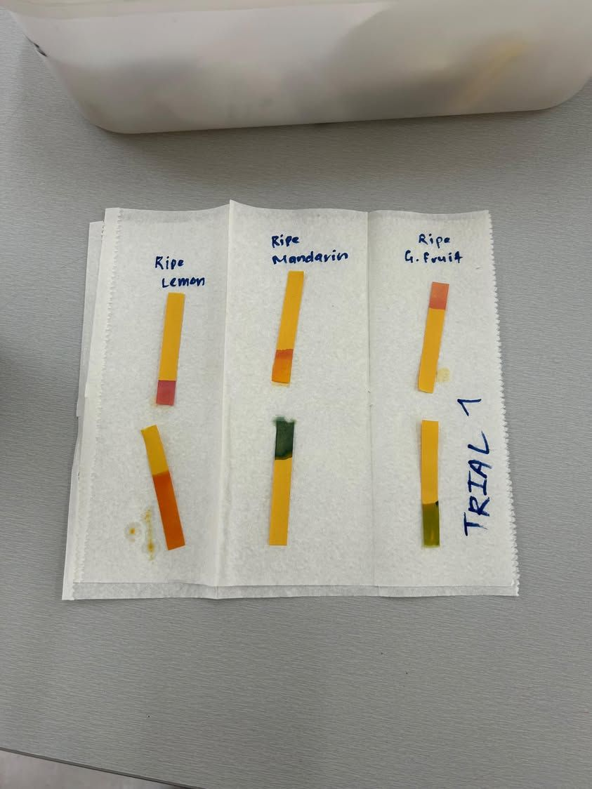
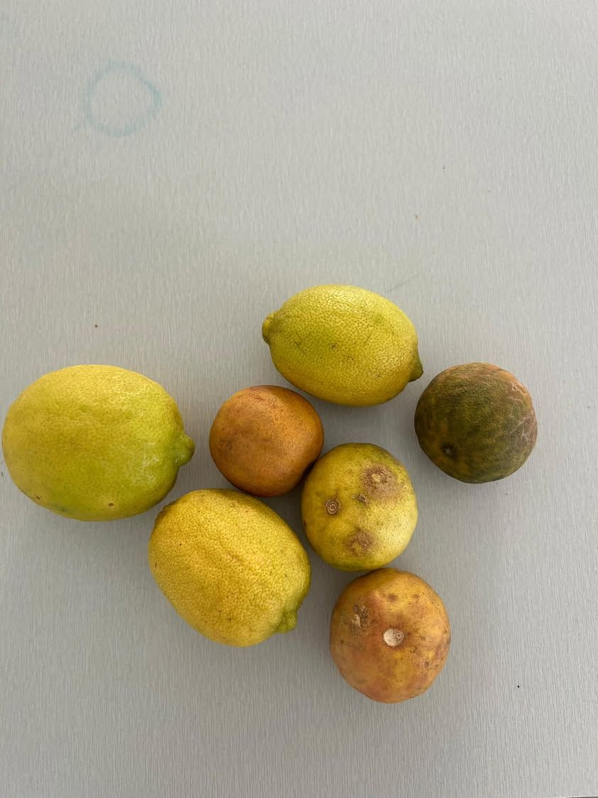

# Sample preparation

Scroll down to view the photos in this folder. Click any photo to open the original image.

## Photo 1

*Original file: half-ripe-pamplemousse-juice.jpg*

## Photo 2

*Original file: labelled-juice-samples-and-ph-strips.jpg*

## Photo 3

*Original file: peeled-citrus-fruit.jpg*

## Photo 4

*Original file: peeled-mandarins.jpg*

## Photo 5

*Original file: reagents-and-juice-samples.jpg*

## Photo 6

*Original file: ripe-grapefruit-juice.jpg*

## Photo 7

*Original file: ripe-mandarin-juice.jpg*

## Photo 8

*Original file: trial-1-labelled-ph-strips.jpg*

## Photo 9

*Original file: whole-citrus-fruit.jpg*

